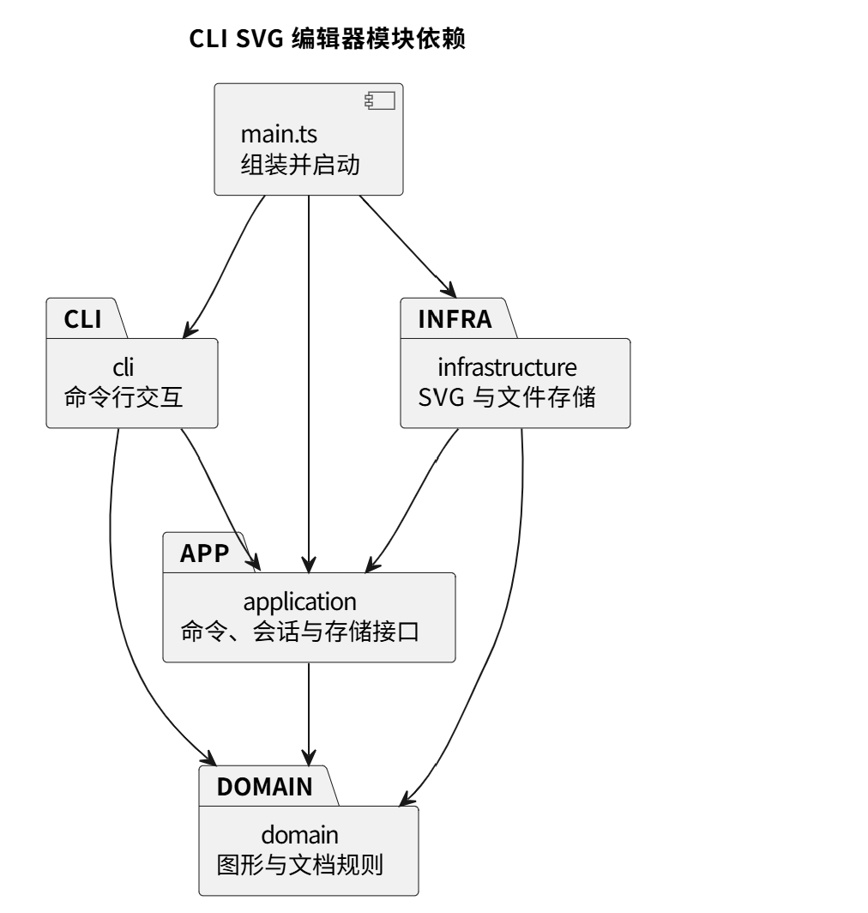

# PJ1 Phase 1：CLI SVG 编辑器

本项目使用 TypeScript 和面向对象方式实现命令行 SVG 编辑器。用户输入命令后，程序修改内存中的图形树，再保存为浏览器可以打开的 SVG 文件。本阶段支持矩形、圆、椭圆、线段、文字和普通分组六种类型。

## 一、架构方案

### 1. 模块划分

项目按“接收输入、执行操作、维护图形、读写文件”划分职责。

| 模块或目录 | 职责 |
| --- | --- |
| `src/cli/`：命令行交互 | 接收逐行输入，处理引号和注释，找到对应命令，统一打印错误和结果。 |
| `src/application/`：应用流程 | 管理当前文档、保存路径、撤销重做，提供图形工厂和存储接口。 |
| `src/application/commands/`：具体命令 | 每个命令类负责一种操作，调用图形和文档的方法。此目录属于 application 模块。 |
| `src/domain/`：图形模型 | 保存图形数据，实现几何操作、属性校验、树结构和 ID 唯一性等规则。 |
| `src/infrastructure/`：文件与 SVG | 将图形树与 SVG XML 文本互相转换，完成文件读取和保存。 |
| `src/main.ts`：程序入口 | 创建需要的对象，把具体存储工具交给应用会话，再启动命令行。 |

此外，`test/` 存放自动化测试，`scripts/` 存放架构检查脚本，`examples/` 存放示例命令和 SVG 文件。

下面的 PlantUML 包图表示允许的主要模块依赖：

### 2. 设计模式的选择

**Command（命令模式）**

选择原因：创建、删除、移动等操作需要统一执行，而且一条编辑命令应对应一个撤销单元。

实现方式：所有命令继承 Command，通过 `execute(session)` 执行。可撤销的编辑命令进一步继承 EditCommand，通过 `apply(document)` 完成具体修改。MoveCommand 负责移动，SetCommand 负责修改属性，其他操作各有对应类。

EditCommand 将编辑过程交给 EditorSession 统一管理，避免各个命令重复维护历史。具体命令通过 `undoMessage(...)` 描述恢复结果，确保撤销后的坐标、文字和父容器反馈正确。

**Composite（组合模式）**

选择原因：同一个移动或缩放命令既要处理单个图形，也要处理包含多层子图形的分组。

实现方式：五种叶子图形与 Group 都继承 Shape，具有统一操作方法。叶子维护自己的几何属性；Group 保存子图形，并将移动、缩放递归传递给孩子。例如，移动包含矩形和文字的分组时，两者会一起移动，命令不必分别判断类型。

删除由 SvgDocument 移除目标节点，目标是分组时会一起移除整棵子树。分组的公共样式写在 g 元素上，通过 SVG 样式继承生效。

**Memento（备忘录模式，使用文档快照）**

选择原因：删除、分组、跨容器移动可能同时影响多个节点，逐项编写反向操作容易遗漏结构或顺序。

实现方式：HistoryEntry 保存命令对象、修改前后的文档深拷贝和成功反馈。undo 恢复修改前的文档，redo 恢复修改后的文档。EditorSession 用两个栈管理撤销与重做；撤销后发生新编辑时清空重做栈。

Command 负责组织操作，Memento 负责恢复状态。

### 3. 依赖方向规则

| 模块 | 允许依赖 | 原因 |
| --- | --- | --- |
| domain | 本模块 | 图形规则独立于终端、文件系统和交互方式。 |
| application | 本模块、domain | 组织图形操作，通过本层定义的存储接口请求读写。 |
| cli | 本模块、application、domain | 解析输入并调用应用功能，允许使用领域类型，不直接处理文件存储。 |
| infrastructure | 本模块、application、domain | 实现应用的存储接口，并转换领域对象。 |
| main.ts | 上述模块 | 作为入口创建对象并连接依赖。 |

domain 和 application 不直接使用 Node 文件 API，也不导入 cli 或具体的 FileDocumentStore。这样更换输入方式或文件实现时，图形规则无需跟着改变。违反上述规则的依赖应列为待处理项。

按名字分派集中在两处：CommandRegistry 将命令名对应到命令类，ShapeFactory 将类型名对应到图形类。这两处注册表均列为后续插件化阶段的待重构项。

### 4. 变化点假设

-  **交互方式可能从命令行扩展到图形界面：** 
  如果以后通过按钮或鼠标编辑图形，移动、分组和撤销等规则仍然需要使用。因此，当前把终端输入解析与应用流程、图形模型分开，让新的界面可以复用已有操作。

- **可能增加 box 等新的图形类型：** 
  创建不同图形的规则集中在 ShapeFactory 中，移动、缩放等通用操作通过 Shape 提供的统一方法执行。这样增加类型时，主要扩展图形类和工厂中的注册项，不必在每个编辑命令中重复判断类型。

- **可能增加新的编辑命令：** 
  目前每种操作都有独立的命令类，命令名与实现的对应关系集中在 CommandRegistry。增加操作时，可以新增命令类并登记到注册表中，已有命令的实现通常不需要修改。

- **文档的存储方式可能变化：** 
  当前将 SVG 保存在本地文件中，以后可能需要保存到其他位置。为此，EditorSession 通过 DocumentStore 接口请求读写，具体文件处理由 FileDocumentStore 完成，更换存储工具时可以保留大部分应用逻辑。

- **文档规模和编辑历史可能增大：** 
  当前每次编辑都保存完整的前后快照，便于准确恢复分组、删除等复杂操作。但图形和历史记录越多，内存占用也会越大。本阶段优先保证功能正确，暂未设置历史条数上限。以后遇到较大文档时，可以考虑限制历史数量，或只记录发生变化的部分。
