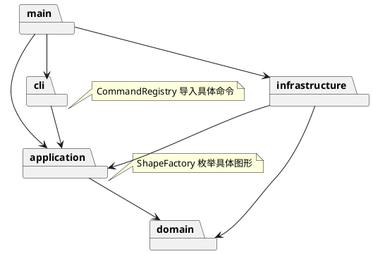
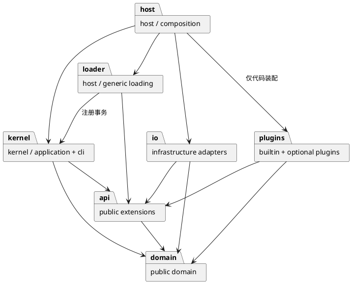
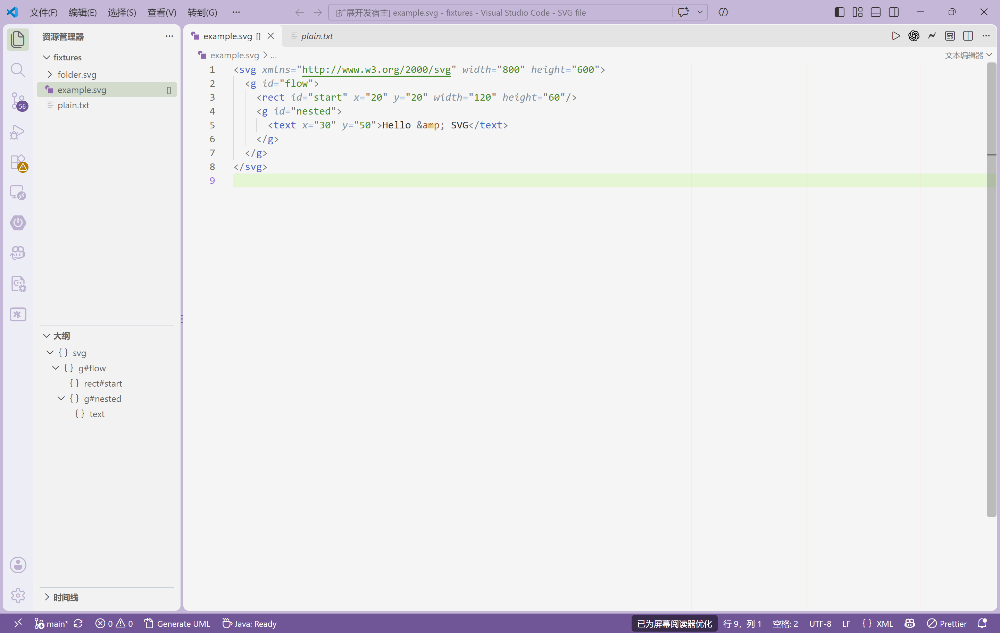
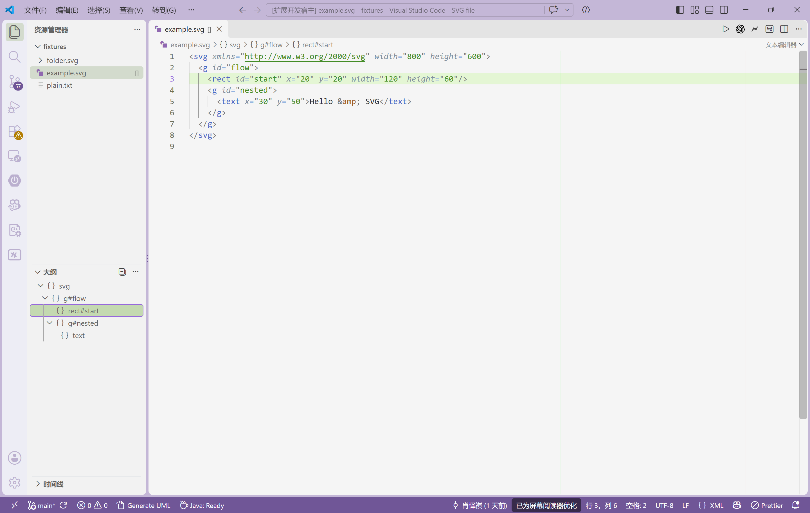
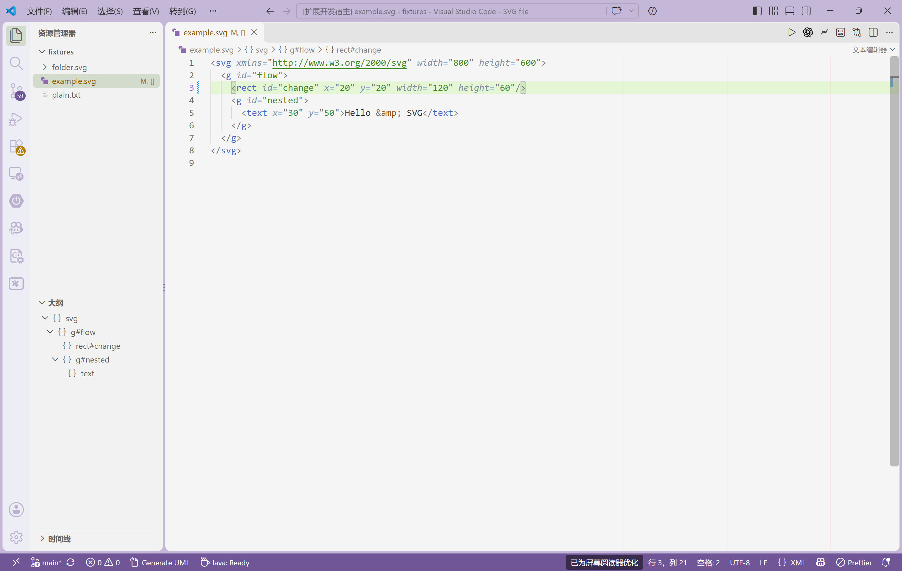
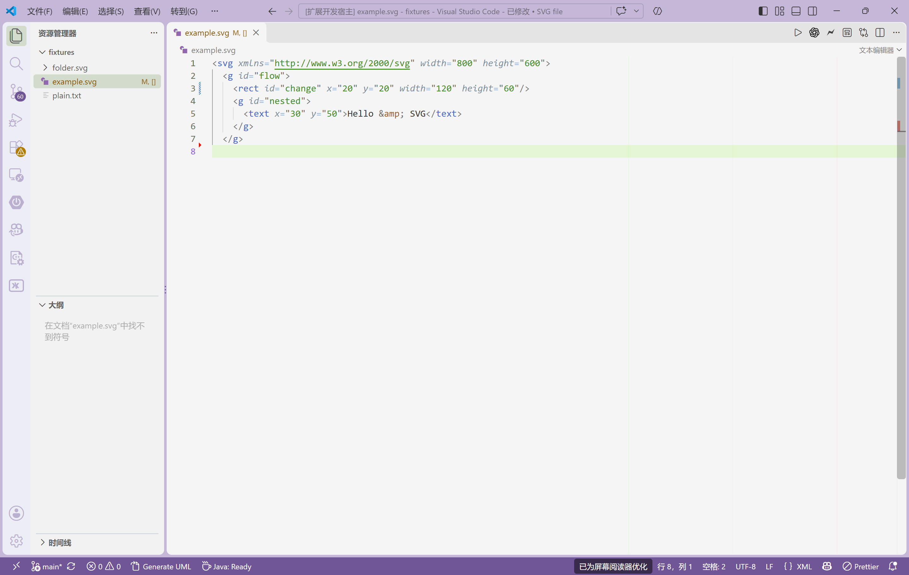

# PJ1 Phase 2：插件实践与 CLI 插件式重构

本项目在 Phase 1 的 SVG 命令行编辑器上增加了插件机制，并开发了一个 VSCode 扩展。CLI 通过插件增加统计、目录查看、box 图形和树标签。VSCode 扩展负责给 SVG 文件添加标记，并在大纲中显示 SVG 的层级。项目使用 TypeScript 和面向对象方式实现。

Phase 1 的最终版本保存在 `final` 标签中，后续通过它检查旧功能是否保持原样。

源码、测试、命令示例、运行截图和代码统计都保存在仓库中。[自动验收结果](validation/acceptance.json) 记录检查是否通过，[交付检查表](acceptance.md) 列出各项要求对应的材料。原 Phase 1 文档保存在 [phase1-report.md](phase1-report.md)，可以用来对照重构前后的变化。

## 1. 安装与启动

CLI 需要 Node.js 22 或更新版本及 npm。扩展需要 VSCode 1.85 或更新版本。

在仓库根目录运行下面两条命令，分别安装 CLI 和 VSCode 扩展的依赖：

```powershell
npm ci
npm --prefix vscode-extension ci
```

选择一种方式启动 CLI：

| 命令 | 启动后的功能 |
| --- | --- |
| `npm run cli` | 启用 Phase 1 的六种图形和 19 条命令，用于检查旧功能 |
| `npm run cli -- --code` | 启动代码中选定的插件，包括 stats、dir、box 和 tree-star |
| `npm run cli -- --config plugins.config.json` | 按配置文件选择插件，当前与代码方式加载相同的四个插件 |


完整自动验收并生成日志：

```powershell
npm run acceptance
```

也可以按需要运行单项检查：

| 命令 | 检查内容 |
| --- | --- |
| `npm run check` | CLI 编译、全部测试和模块依赖检查 |
| `npm run check:baseline` | 比较当前程序与 Phase 1 最终版本的输出 |
| `npm run test:stats` | 单独测试统计插件 |
| `npm run test:dir` | 单独测试目录插件 |
| `npm run test:box` | 单独测试 box 插件 |
| `npm run test:star` | 单独测试星号标签 |
| `npm --prefix vscode-extension test` | 测试 VSCode 文件标记和大纲 |

单个插件的测试会提供它需要的文档或目录接口。多个插件一起运行的结果由集成测试检查。

## 2. 模块职责与依赖变化

| 目录/文件 | 当前职责 |
| --- | --- |
| src/domain | 保存图形和文档数据，处理坐标、层级、id 唯一性、结构检查及完整复制 |
| src/application/extensions | 规定插件怎样注册、命令怎样操作文档、dir 怎样读取目录，统一由 index.ts 导出 |
| src/application | 管理注册表、文档修改和撤销历史，调用图形、属性及标签插件，生成树形输出 |
| src/cli | 读取用户输入，拆分命令和参数，查找命令并输出结果或错误 |
| src/infrastructure | 读写 SVG 文件，通过 NodeDirectoryAdapter 读取真实目录 |
| src/host | 启动程序，选择插件，读取配置，检查插件清单并统一完成安装 |
| src/plugins/builtin | 提供 Phase 1 的原有命令和六种图形，启动时统一注册 |
| src/plugins/command-stats、command-dir | 两个独立命令插件包 |
| src/plugins/shape-box | 提供 box 图形、SVG 读写、fill/label 修改及 (box) 标签 |
| src/plugins/tree-star | 比较当前内容和上次保存的内容，为发生变化的节点添加星号 |
| vscode-extension | 单独的 VSCode 工程、示例和扩展测试 |
| scripts、test、doc/transcript、doc/validation | 分别保存检查脚本、测试代码、命令输入与预期输出、实际运行记录 |

重构前，增加命令需要修改 CommandRegistry，增加图形需要修改 ShapeFactory。设置属性和输出树也直接写在原命令中。

重构后，框架先定义接口，具体功能由插件登记。以 box 为例，框架收到 create box 后，从注册表找到 BoxProvider，再交给它创建图形。这样可以通过新增插件来扩展功能。Shape、Group 等图形类继续供插件使用。

`scripts/check-architecture.cjs` 会检查代码导入了哪些模块，包括通过其他文件再次导出的内容。允许的依赖方向如下：

- domain 使用本目录的图形和文档代码。
- application 使用应用层和 domain。
- CLI 和 infrastructure 通过应用接口及图形模型完成工作。
- 插件从 `src/application/extensions/index.ts` 获取公开接口，并使用 domain 中的图形类及本插件代码。
- host 在启动时创建对象，并将各模块连接起来。

下面两张图中的箭头表示“左边使用右边的代码”。

**重构前 PlantUML**：



**重构后 PlantUML**：



## 3. 四个扩展点清单

四个接口都定义在 src/application/extensions。插件用类实现接口，创建对象后登记到框架中。

| 扩展点 | 职责 | 内核调用它的位置 | 已有实现 | 禁用或未匹配时的行为 | 出错处理 |
| --- | --- | --- | --- | --- | --- |
| ShapeProvider<br>增加图形类型 | 创建一种图形，并处理它的 SVG 保存和读回。<br>例：BoxProvider 将 create box 的参数变成一个包含矩形和文字的 Box 对象。 | src/application/ShapeFactory.ts 的 create、fromSvg、toSvg，配合 src/infrastructure/SvgCodec.ts 的 encode、decode。 | BuiltinShapeProvider 的六个实例提供原有图形，BoxProvider 提供 box。 | 原有六种图形继续工作。create box 报 unknown shape type。带 box 标记的 SVG 分组按普通 g 读入。 | 同名注册或相同读回标识会被拒绝。创建结果的 id、结构或保存结果格式错误时，框架报错。如果多个提供者都声称负责同一对象，保存时报 shape provider conflict。 |
| Command<br>增加命令 | 提供命令名称、帮助文字、参数检查和执行方法。<br>例：输入 stats 后，框架找到 StatsCommand 并调用它的 execute。 | src/cli/CommandRegistry.ts 的 execute、help，以及 CommandProcessor.ts 的 run。 | BuiltinCommand 连接原有命令，StatsCommand 和 DirCommand 提供新增命令。 | help 只展示已加载的命令。执行已禁用的 stats 或 dir，输出 error: unknown command: name。 | 重复命令名拒绝注册。参数错误由命令报告。返回结果格式错误时报 invalid command result。错误统一以 error: 开头。 |
| AttributeHandler<br>规定属性怎样修改 | 确定某种图形的某个属性实际要改哪里。<br>例：set n1 fill red 修改 box 内部矩形，set n1 label "开始" 修改内部文字。 | SessionFacade.setAttribute 将请求交给 EditorSession.setAttribute。后者通过 edit 建立一次可撤销操作，再调用 src/application/AttributeService.ts 的 apply。 | BoxAttributeHandler 负责 box 的 fill 和 label。 | 继续使用 Shape.set 的原有属性规则。普通矩形设置 label 会报 unknown attribute。 | 多个处理器同时匹配时报 attribute handler conflict。修改中途抛错时，恢复文档和历史记录。 |
| TreeDecorator<br>给树形输出添加标签 | 决定某一行末尾是否添加 * 或 (box) 等文字。<br>例：BoxTypeDecorator 为 box 行返回 (box)，ModifiedStarDecorator 为有未保存变化的行返回 *。 | 成功操作后，EditorSession 通过 src/application/TreeLabels.ts 的 notify 通知标签。输出树时，TreeRenderer.render 通过 TreeLabels.suffix 取得各标签文字。 | BoxTypeDecorator 和 ModifiedStarDecorator。 | tree 输出与 Phase 1 逐字节相同，包括空格和换行。 | 标签报错或返回格式错误时，框架禁用该标签并输出错误，其他标签继续工作。 |

四个注册方法分别是 ExtensionRegistry.registerShape、registerCommand、registerAttribute 和 registerDecorator。它们检查对象是否提供规定的方法、名称是否有效、是否重名。

PluginContext 是插件注册功能时使用的对象。SessionApi 是命令操作文档时使用的接口。命令通过它读取文档副本或提交修改，框架统一处理撤销、重做和失败恢复。正常启动时，默认插件提供 Phase 1 的全部功能。验证代码见 test/extensions.test.ts。

## 4. 两种装配、配置格式与共同加载路径

- **代码装配**：在 `src/host/CliStartup.ts` 中导入插件对象和清单，再调用 `host.installer.install(manifest, plugin, options)`。
- **配置装配**：在 JSON 文件中写插件路径。PluginConfigLoader 按路径找到插件，读取它的 package.json 和默认导出对象，再调用同一个 install 方法。

install 负责检查插件并完成注册。activate 是插件的初始化方法，它在其中登记自己提供的功能。

```json
{
  "plugins": [
    { "module": "./dist/src/plugins/command-stats" },
    { "module": "./dist/src/plugins/command-dir" },
    { "module": "./dist/src/plugins/shape-box" },
    { "module": "./dist/src/plugins/tree-star", "enabled": true, "options": {} }
  ]
}
```

程序先检查整个配置格式，再开始逐个加载。配置格式出错时，会报告错误并继续启动原有功能。构建命令将 TypeScript 编译为 JavaScript，并把各插件的 package.json 复制到 dist。

每个插件的 package.json 中还要写清楚它提供哪些功能，即插件清单。Box 的清单如下：

```json
{
  "name": "@svgframe/plugin-shape-box",
  "main": "BoxPlugin.js",
  "contributes": {
    "shapes": ["box"],
    "attributes": ["box-attributes"],
    "decorators": ["box-type-label"]
  }
}
```

这里的 shapes、commands、decorators、attributes 分别对应四个扩展点。Box 声明自己提供一种图形、一个属性处理器和一个树标签。

一次安装按下面的顺序执行：

1. 检查插件清单和默认导出对象是否有效。
2. 调用 activate，将注册结果先放在临时表中。
3. 检查清单中声明的名称，是否与实际注册的名称完全一致。
4. 全部通过后，将临时表中的功能加入正式注册表。
5. 如果中途失败，丢弃本插件的临时结果，继续加载后面的插件。之前成功安装的插件保留。

activate 返回后，注册入口随即关闭。加载器支持 CommonJS（CJS）、编译后的 TypeScript 和 ES Module（ESM）。模块本身可以异步加载，activate 中的注册过程需要同步完成。

| 失败 | 固定输出 |
| --- | --- |
| 顶层模块找不到 | error: plugin not found: module |
| 无 default 导出 | error: plugin has no default export: module |
| 清单与实际注册不符 | error: plugin manifest mismatch: name (declared: …, registered: …) |
| 激活/求值/依赖失败 | error: plugin failed to activate: name (reason) |
| 同类同名 | error: duplicate registration: category/name |
| 配置语法/结构错误 | error: invalid plugin config |

如果插件自己捕获了重复注册错误，框架仍会取消这次安装，避免只装上一部分功能。加载器按配置路径查找模块，代码装配所需的具体导入集中在启动文件中。检查记录见 [历史与加载器核验](validation/history.json)。

## 5. 设计模式、功能与适配器

### Command：每条命令由一个对象负责

命令对象保存名称、帮助文字和执行方法。例如 StatsCommand 负责统计，DirCommand 负责列目录。框架按命令名找到对象，再调用 execute。

Phase 1 的命令对象是每次操作时创建的。BuiltinCommand 把这种原有写法接到新的命令接口上，因此旧命令可以继续使用。ExecutableCommand 和 EditCommand 是供这些命令继承的基类，SessionApi 负责连接文档操作。

### Composite：单个图形和整组图形使用相同操作

矩形、文字和分组都继承 Shape。调用 move 时，矩形移动自身坐标，分组将移动传给各个孩子。Box 也是容器，因此移动 box 时，内部矩形、文字和嵌套图形一起移动。

### Memento：用文档副本保存撤销历史

EditorSession 每次编辑先复制当前文档，在副本上执行操作。成功后保存修改前后的两个版本，以及对应的反馈文字。HistoryEntry 负责保存这些历史。

undo 恢复修改前的版本，redo 恢复修改后的版本。如果中途出错，就保留原文档和原有历史。这使删除整个分组、同时修改多个子部件等操作也能用一次 undo 恢复。

### Adapter：dir 通过统一接口读取目录

DirCommand 负责排序和生成显示文字。读取真实文件系统的工作交给 NodeDirectoryAdapter。它们之间使用 DirectoryAccess 接口，因此测试时可以换成预先准备好目录条目的替身。

| 适配器模式角色 | 本项目对象 | 实际工作 |
| --- | --- | --- |
| Client，使用者 | DirCommand | 请求目录条目，排序后输出 |
| Target，统一接口 | DirectoryAccess | 规定怎样取得当前目录、怎样读取条目 |
| Adapter，转换者 | NodeDirectoryAdapter | 将 Node 文件系统 API 的结果转成统一的目录条目 |
| Adaptee，被转换的接口 | node:fs.readdirSync、Dirent、process.cwd | 提供真实的目录内容、文件类型和进程工作目录 |

目录输出规则：

- 列出当前工作目录的直接子项，保留隐藏文件。
- 目录在前，普通文件在后。各组使用相同的字符比较规则升序排列，保证排序稳定。
- 符号链接等特殊项用 [OTHER] 放在最后。每个标记后有两个空格。
- 空目录输出 (empty directory)，读取失败输出 error: cannot read directory: 路径。
- read/save 保持工作目录原样。dir 执行成功或失败，都保留文档、保存路径、修改状态和撤销重做记录。

### 树标签与 OCP：新增功能通过注册接入

OCP 是开闭原则，强调给已有程序增加能力时，尽量通过扩展来完成。

TreeRenderer 负责生成基础树形文字，再向所有 TreeDecorator 请求行尾标签。BoxTypeDecorator 返回 (box)，ModifiedStarDecorator 按内容变化决定是否返回 *。新增标签时增加实现并注册，树渲染代码保持原样。它体现了给现有显示附加职责的装饰思想，经典 Decorator 的结构差异集中列于文末。

### stats 与 box 的具体行为

stats 从画布的第一个孩子开始，先遍历它的子树，再遍历下一个孩子。这称为按顺序深度优先遍历。叶子图形按类型计数，输出顺序取各类型第一次出现的顺序。分组和 box 计入容器数量，box 内部的矩形和文字继续作为叶子统计。

box 的 fill 表示内部矩形的填充色，label 表示内部文字。BoxAttributeHandler 实现这两种修改。原有图形仍使用 Shape.set 中规定的可修改属性。

## 6. ADR（四项决策）

### ADR-001：属性修改由谁处理，失败怎样恢复

每个 AttributeHandler 先用 handles 判断自己是否负责目标图形和属性。框架传给它的是图形副本。如果多个处理器都匹配，框架报冲突错误。

实际修改在一次 edit 中完成。框架准备好修改前后文档和撤销文字后，才保存结果。例如，一条命令改了两个子部件，它们仍是一个撤销单位。中途抛错时，文档和 undo/redo 记录一起保持原状。

验证见 test/extensions.test.ts 和 test/box-integration.test.ts，包括处理器冲突和修改两个部件后故意抛错的情况。

### ADR-002：box 怎样保存、读回和保护内部结构

box 内部矩形的 id 为 id-rect，文字的 id 为 id-label。创建前检查容器和所有子节点的 id，任意一个冲突都会使整条命令失败。

保存时写成带 data-kind="box" 的 g。读入时，已加载 box 插件就还原为 Box，未加载就按普通分组保留内容。已加载插件但必要部件缺失或类型错误时，拒绝整次读入，保留原文档。重复 id 始终报错。

Box 通过结构检查保护两个必要部件，直接拆出部件或 ungroup box 会报错。整体移动、删除、分组和继续嵌套都可用。复制文档时，Box 类型、孩子顺序和样式一并保留。

### ADR-003：什么时候显示星号，星号是否传给祖先

星号表示“当前内容与上次成功保存或读入的内容不同”。init 以刚创建的空画布为起点，所以初始无星。新建节点立即有星，修改文字或属性也会产生星号。

子节点变化时，祖先容器和 SVG 根也标星。其他兄弟节点按自己的内容判断。保存成功后清除星号，之后再次编辑会重新显示。undo 回到保存时的内容，星号消失，redo 后重新出现。失败操作保留原来的比较基准。

ModifiedStarDecorator 将比较用的数据保存在自己的私有字段中。比较时忽略属性的插入顺序，但保留孩子顺序。多个标签按插件加载和注册的顺序显示，当前是 (box) *。

保存后的撤销限制继续遵守 Phase 1。“undo 回保存点”是指保存后再编辑，然后撤销这次编辑。

### ADR-004：什么时候检查清单，注册失败怎样处理

先检查完整配置格式，再逐个加载插件。每个插件的注册结果先进入临时表。activate 返回后，框架比较清单声明和实际注册结果，全部通过才加入正式表。

重名、清单不符或激活抛错时，取消当前插件的全部注册，保留之前成功的插件，再继续下一项。activate 只负责注册功能，返回后注册入口关闭。

验证见 test/loader.test.ts，覆盖四条加载失败路径、重复注册、回滚和上下文关闭后的调用。

## 7. VSCode 实践、模式分析与复用评估

### 启动与运行截图

1. 用 VSCode **打开 vscode-extension 文件夹**，在终端运行 npm ci。
2. 按 F5，选择 Run SVG Extension。VSCode 会编译扩展，再打开一个“扩展开发宿主”窗口用于调试。
3. 在新窗口中用文本编辑器打开 example.svg，展开左侧“大纲 / Outline”。
4. 如果文件默认打开成图形预览，选择“重新打开编辑器的方式→文本编辑器”，并将 SVG 的默认编辑器设为 default。

本轮实际运行确认了以下效果：

- SVG 文件右侧显示 []。
- 大纲按照 SVG 的父子关系显示根元素、分组和叶子。没有 id 的文字元素显示为 text。
- 在大纲打开 rect#start，可以定位到源码第 3 行。
- 修改 id 后，大纲中的名称随之更新。
- 输入缺少结束标签的 XML 时，大纲安全清空。

下面是本次实际运行的截图。

真实 SVG 文件显示标记:

原生大纲层级及 rect#start 源码定位:

修改 id 后大纲更新:

缺少结束标签时安全清空大纲:



### 宿主与插件的调用关系

VSCode 负责显示资源管理器、大纲和文本编辑器。扩展负责告诉 VSCode：哪些文件加标记、SVG 有哪些元素、这些元素对应哪段源码。

启动时，extension.ts 的 activate 创建两个提供者对象，并调用下面的 API 登记功能：

- window.registerFileDecorationProvider：登记文件标记功能。
- languages.registerDocumentSymbolProvider：登记文档大纲功能。

登记完成后，由 VSCode 在需要时调用扩展。例如，显示一个文件时调用 SvgDecorationProvider，获取 [] 标记。打开或编辑 SVG 时调用 SvgOutlineProvider，获取大纲节点。context.subscriptions 保存登记时返回的资源，扩展停用时统一释放。

SvgOutlineProvider 每次读取编辑器当前的 document.getText。SvgStructureParser 解析标签、id、父子关系和字符位置，再由提供者转成 DocumentSymbol：name 是显示名称，children 是子节点，range 是整个元素的位置，selectionRange 是点击后定位的位置。字符位置使用 UTF-16 偏移，与 VSCode 的文本位置规则一致。

### Decorator 与 Adapter 的对应与差异

文件标记体现了“给已有对象附加显示信息”的想法。SvgDecorationProvider 返回 FileDecoration，VSCode 将它和原文件条目一起显示。它与经典 Decorator 在包装结构上的差异集中列于文末。

大纲中的 Adapter 更容易对应到代码。解析器产生的是 SVG 元素节点，VSCode 需要的是 DocumentSymbol。SvgOutlineProvider 在两种结构之间完成转换：

| 模式角色 | 对应对象 |
| --- | --- |
| Client，使用结果的一方 | VSCode 原生 Outline |
| Target，VSCode 要求的接口 | DocumentSymbolProvider |
| Adaptee，原有数据来源 | SvgStructureParser 解析出的元素树 |
| Adapter，完成转换的一方 | SvgOutlineProvider |

文件标记也有类似的转换过程：把文件路径和文件类型转换为 VSCode 要求的 FileDecoration。

### Phase 1 代码复用评估

| 模块 | 结论与原因 |
| --- | --- |
| SvgCodec / fast-xml-parser 的 CLI 解析流程 | 本次另写结构解析器。大纲需要知道每个元素在源码的哪一行，还要保留没有 id 的元素。原 CLI 解析器主要负责创建可编辑图形，并会自动补 id，职责不同。 |
| Shape / Group / SvgDocument | 这些类适合保存图形和执行移动、缩放。本次大纲只需要标签、层级和源码位置，因此使用更简单的元素节点。 |
| 树遍历思路 | 复用按父子关系遍历的思路。CLI 生成文字行，Outline 生成带源码位置的节点，各自处理输出。 |
| Tokenizer / Command / EditorSession | 负责 CLI 命令、文档编辑和撤销。本次 VSCode 功能直接响应编辑器的请求，因此使用 VSCode 提供者接口。 |
| 通用 XML 结构解析 | 使用 saxes 解析 XML 并记录源码位置，同时处理注释、CDATA、转义实体和命名空间。 |

## 8. 验证、差异证据与指标

acceptance 脚本依次编译程序、运行测试、比较旧版本输出，再检查两种装配结果和 Git 改动。每项检查的运行记录见 [validation](validation/acceptance.json)。

| 验证 | 证据 |
| --- | --- |
| 每个插件单独测试，以及修改成功或失败时的状态 | stats.test.ts、dir.test.ts、box.test.ts、modified-star.test.ts，以及 extensions/box/command/tree-labels 集成测试 |
| 目录替身与真实适配 | dir.test.ts，包含混合项、隐藏项、空目录、稳定排序、失败和临时目录 |
| 加载四失败路径/重复/回滚 | loader.test.ts。无效配置全量预检、依赖缺失分类、ESM、上下文失效亦覆盖 |
| 禁用新插件与 final 字节兼容 | check-baseline.cjs，cli-1/cli-1a/cli-core 的 stdout 及保存 SVG |
| 两种装配的结果比较 | verify-assembly.cjs 使用相同插件、顺序、参数、工作目录和初始文件，执行基础、流程图、box、命令插件及标签五组命令。两次输出保存在 validation/assembly |
| 新增插件时旧代码是否保持原样 | verify-history.cjs 先确认被查目录存在，再排除新增插件文件，检查旧代码的 Git 差异，并记录加载器检查结果 |

两条 box 演示分支：codex/box-code-demo（4be3625）与 codex/box-config-demo（b82bd1e）。

```powershell
git --no-pager diff --name-status "codex/box-code-demo~1" "codex/box-code-demo"
git --no-pager diff --name-status "codex/box-config-demo~1" "codex/box-config-demo"
```

代码装配分支新增 box，并修改启动文件 CliStartup。配置装配分支新增 box，并修改 plugins.config.json。两者都保持内核、加载器和旧插件原样。

两份提交还包含 box 独立测试，以及固定旧测试所用插件的调整。逐项记录见 [演示记录](box-demo-evidence.json)。verify-history 也检查命令插件和树标签接入时的改动。

命令中的 ~1 表示该提交的前一次提交，因此这两条命令能列出“接入 box 这一次改了哪些文件”。

[generate-metrics.cjs](../scripts/generate-metrics.cjs) 从 Git 读取两个版本的代码，自动统计文件职责、内核/装配/插件三类代码行数，以及每个函数的圈复杂度。圈复杂度反映函数中判断、循环等执行分支的数量，计算规则写在脚本和报告中。

结果保存在 [docs/metrics](../docs/metrics/README.md)。VSCode 扩展单独统计。统计范围是运行源码，排除依赖、编译结果、测试和脚本。评估重构时，同时检查旧功能是否保持、依赖方向是否正确，以及新增插件实际修改了哪些文件。

使用 `npm run metrics -- --from final --to HEAD` 生成已提交代码候选指标。最终版本的历史对照使用 `--to p2`。

## 9. AI 协作检查与修正

| 检查发现 | 修正及验证 |
| --- | --- |
| Token 的 getter 被对象展开丢失 | 改为显式读取 value/isQuoted，检查带空格与带引号 in 参数。 |
| 插件回调可能在生成 undo 反馈时抛错 | 将反馈准备前移到提交之前，注入失败检查文档与历史不变。 |
| 复合图形默认克隆可能退化成 Group | 增加子类型/内容/共享对象检查，Box 自行深克隆并保护必要部件。 |
| 编辑器提示旧 moduleResolution 与 Node 类型问题 | 扩展迁移 Node16 配套配置。根项目显式声明 node 类型，编译验证通过。 |